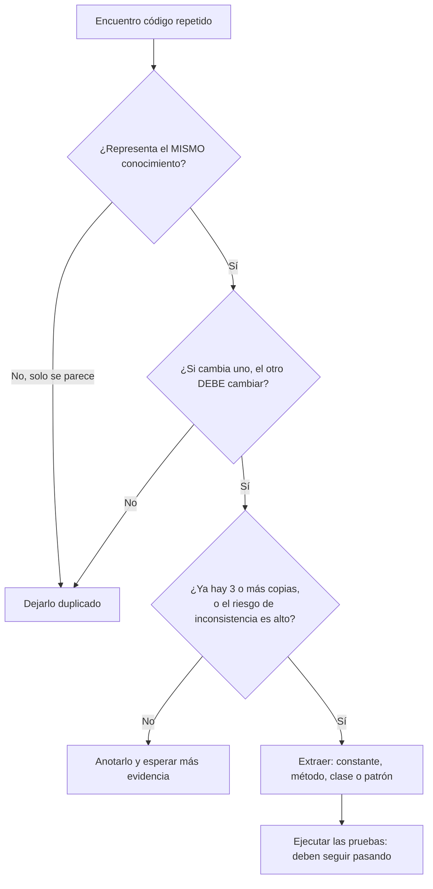

# Teoría: principios KISS y DRY

Este documento acompaña los ejercicios del proyecto. Al final de cada sección se indica
qué ejercicio practica cada idea.

---

## 1. KISS — *Keep It Simple, Stupid*

### 1.1 Definición
> **La mayoría de los sistemas funcionan mejor si se mantienen simples en lugar de complicados.
> La simplicidad debe ser un objetivo de diseño y se debe evitar la complejidad innecesaria.**

**Origen:** la frase se atribuye a Kelly Johnson, ingeniero de Lockheed (Skunk Works) en los años 60.
Pedía que los aviones se diseñaran para que un mecánico promedio pudiera repararlos en combate
con herramientas básicas. Aplicado al software, el "mecánico" es el próximo programador que lea
el código. Muchas veces ese programador es uno mismo, seis meses después.

### 1.2 ¿Por qué importa?
- El código se **lee** muchas más veces de las que se escribe.
- Cada condición, bandera o capa extra es un lugar más donde puede esconderse un error.
- El código simple es más fácil de **probar, depurar y cambiar**.

> "Hay dos formas de construir un diseño de software: hacerlo tan simple que obviamente no
> tenga deficiencias, o hacerlo tan complicado que no tenga deficiencias obvias."
> — C. A. R. Hoare

> "Depurar es el doble de difícil que escribir el código. Por lo tanto, si escribes el código de la
> forma más ingeniosa posible, por definición no eres lo suficientemente inteligente para depurarlo."
> — Brian Kernighan

### 1.3 Simple no es lo mismo que fácil ni que corto
| Concepto | Significado | Ejemplo |
|---|---|---|
| **Simple** | Pocas partes entrelazadas, se entiende de una vez | `return numero % 2 == 0;` |
| **Fácil** | Familiar o rápido de escribir *para mí* | Copiar y pegar un bloque (fácil, pero no simple) |
| **Corto** | Pocas líneas | Una sola línea con 4 ternarios anidados: corta, pero no simple |

Un código simple **no siempre es el más corto**. El objetivo es que se entienda con facilidad.

### 1.4 Síntomas de que se está violando KISS
1. **Anidación profunda** (código "pirámide" o "flecha"): `if` dentro de `if` dentro de `if`…
2. **Banderas booleanas** que se arrastran por el método (`esValido`, `encontrado`, `ok`).
3. **Reinventar la rueda:** ciclos o algoritmos para lo que ya resuelve el lenguaje (`%`, `Math.max`, `String.join`, streams).
4. **Comparaciones redundantes:** `if (x == true) return true; else return false;`
5. **Sobre-ingeniería:** interfaces, fábricas, singletons o capas "por si algún día…".
6. **Métodos largos** que hacen varias cosas a la vez.
7. **Números y textos mágicos** cuyo significado hay que adivinar.

### 1.5 Técnicas para aplicar KISS
| Técnica | Descripción |
|---|---|
| **Cláusulas de guarda** | Rechazar los casos inválidos al inicio y retornar o lanzar de inmediato. Elimina la anidación. |
| **Usar la librería estándar** | Antes de escribir un algoritmo, buscar si ya existe. |
| **Nombres que explican** | Un buen nombre de método o variable evita comentarios y abstracciones. |
| **Extraer métodos pequeños** | Cada método hace una sola cosa (p. ej. `tarifaBase(destino)`). |
| **Estructuras de datos en lugar de condicionales** | Un arreglo o un `Map` en lugar de 7 `if` encadenados. |
| **Constantes con nombre** | `PESO_LIBRE_KG` en lugar de `10`. |
| **YAGNI** | No construir lo que no se ha pedido (ver 1.6). |

### 1.6 KISS y YAGNI (*You Aren't Gonna Need It*)
YAGNI, de Programación Extrema (XP), dice: **"No implementes algo hasta que realmente lo necesites."**
Es la forma más común de aplicar KISS al **diseño**:

- Un patrón de diseño se justifica cuando resuelve un **problema que ya existe**, no uno imaginado.
- El código especulativo cuesta dos veces: al escribirlo y cada vez que alguien lo lee o lo mantiene.
- Si el requisito llega, se agrega la abstracción en ese momento, cuando ya se conoce su forma real.

### 1.7 Cuándo la complejidad SÍ se justifica
KISS no prohíbe la complejidad; prohíbe la complejidad **innecesaria**. Es válido agregar estructura cuando:
- hay **duplicación real** que eliminar (ver DRY),
- hay **variaciones reales** del comportamiento (varios formatos, varios proveedores),
- lo exige un requisito no funcional medido (rendimiento, seguridad, concurrencia).

### 1.8 Ejercicios que lo practican
| Ejercicio | Idea que practica |
|---|---|
| `kiss.basico` | Usar el lenguaje (`%`, arreglos, `Math.max`), eliminar anidación y comparaciones redundantes |
| `kiss.intermedio` | Cláusulas de guarda, eliminar banderas, constantes con nombre, extraer método |
| `kiss.avanzado` | Sobre-ingeniería y YAGNI: 8 tipos reemplazados por 1 clase |

---

## 2. DRY — *Don't Repeat Yourself*

### 2.1 Definición
Formulado por Andy Hunt y Dave Thomas en *The Pragmatic Programmer* (1999):

> **"Todo fragmento de conocimiento debe tener una representación única, inequívoca y
> autorizada dentro de un sistema."**

La palabra clave es **conocimiento**, no "código". DRY no trata de evitar líneas parecidas.
Trata de que **cada regla del negocio o decisión técnica esté definida en un solo lugar**.

| Conocimiento | Ejemplo de violación DRY | Representación única |
|---|---|---|
| Regla de negocio | "Se aprueba con 3.0" escrito en 3 métodos | `NOTA_APROBATORIA` |
| Algoritmo | El cálculo del IVA copiado en 3 reportes | `CalculadoraVenta` |
| Validación | La regex del correo en 2 métodos | `Validador.correo()` |
| Estructura de datos | `nombre` y `correo` en `Estudiante` y `Docente` | Superclase `Persona` |
| Documentación | Un comentario que repite lo que dice el código | Un buen nombre de método |

### 2.2 ¿Por qué importa?
Cuando un conocimiento está duplicado y cambia, **hay que encontrar y modificar todas las copias**.
Si se olvida una, el sistema queda **inconsistente**: por ejemplo, estudiantes y docentes con reglas
de correo distintas. Este error es silencioso. El código compila y las pruebas pueden pasar,
pero el comportamiento está mal.

### 2.3 Tipos de duplicación (según *The Pragmatic Programmer*)
| Tipo | Causa | Ejemplo |
|---|---|---|
| **Impuesta** | El entorno parece obligar a duplicar | Las mismas reglas en el frontend y en el backend |
| **Inadvertida** | No nos damos cuenta | Guardar `edad` y `fechaNacimiento` (una se deriva de la otra) |
| **Por impaciencia** | Copiar y pegar "porque es más rápido" | `promedioFisica` copiado de `promedioMatematicas` |
| **Entre desarrolladores** | Dos personas implementan lo mismo | Dos clases de utilidades de fechas en el mismo proyecto |

### 2.4 Síntomas de que se está violando DRY
1. Métodos cuyo nombre difiere en una palabra y cuyo cuerpo es idéntico (`promedioX`, `promedioY`).
2. El mismo número o texto literal en varios archivos (`0.19`, `"%.2f"`, una regex).
3. Clases con los mismos atributos y getters.
4. Al corregir un error, hay que "acordarse" de corregirlo también en otro sitio.
5. Las **pruebas también se duplican** para cubrir cada copia.

### 2.5 Técnicas para aplicar DRY
| Técnica | Cuándo usarla | Ejercicio |
|---|---|---|
| **Constantes** | Un valor con significado de negocio | `dry.basico` |
| **Extraer método / parametrizar** | Dos métodos iguales salvo un dato | `dry.basico` |
| **Clase utilitaria** | Reglas reutilizadas por varias clases | `dry.intermedio` (`Validador`) |
| **Herencia / superclase** | Varias clases comparten estado y comportamiento ("es un") | `dry.intermedio` (`Persona`) |
| **Composición** | Comparten comportamiento pero no son del mismo tipo | — |
| **Template Method** | Varios procesos con el mismo algoritmo y pasos que varían | `dry.avanzado` |
| **Validar en el constructor** | Garantizar invariantes de una entidad en un solo punto | `dry.intermedio`, `dry.avanzado` |

### 2.6 Cuidado: no toda repetición es duplicación
**Duplicación accidental (coincidental):** dos fragmentos de código *se parecen hoy*, pero representan
**conocimientos distintos** que cambiarán por razones distintas. Si se unifican, un cambio en una regla
rompe la otra.

> Ejemplo: la longitud máxima del nombre de usuario y la del nombre de producto son 50.
> Son reglas independientes. Usar una sola constante `MAX_50` para ambas **no** es DRY: es acoplamiento.

> "La duplicación es mucho más barata que la abstracción equivocada." — Sandi Metz

**Regla de tres** (Don Roberts, citada por Martin Fowler en *Refactoring*):
1. La primera vez, simplemente se escribe.
2. La segunda vez, se duplica con cierta incomodidad.
3. **La tercera vez, se refactoriza.**

Con tres casos ya se ve qué es común y qué varía, así que la abstracción tiene más probabilidad de ser la correcta.

### 2.7 Lo contrario de DRY: WET
*WET* = *Write Everything Twice* / *We Enjoy Typing*: código con el mismo conocimiento repetido en muchos lugares.

---

## 3. KISS y DRY juntos

### 3.1 La tensión entre ambos
| | KISS | DRY |
|---|---|---|
| **Pregunta** | ¿Es esto lo más simple que funciona? | ¿Está cada conocimiento en un solo lugar? |
| **Riesgo si se ignora** | Código enredado y difícil de leer | Inconsistencias al cambiar algo |
| **Riesgo si se exagera** | Código "simple" lleno de copias | Abstracciones prematuras, complejas y acopladas |
| **Herramienta típica** | Simplificar, eliminar, usar el lenguaje | Extraer, parametrizar, abstraer |

Aplicar DRY casi siempre **agrega una abstracción** (método, clase o patrón), y cada abstracción
agrega complejidad. El equilibrio es este:

> **Abstraer cuando la abstracción reduce más complejidad (copias, inconsistencias) de la que agrega.**

Los ejercicios avanzados lo muestran en sentido contrario:
- En **`kiss.avanzado`**, los patrones (Factory, Singleton, Strategy, Template Method) **sobran**: no había
  duplicación ni variaciones reales. Quitarlos simplifica.
- En **`dry.avanzado`**, el Template Method **sí se justifica**: elimina un algoritmo copiado tres veces
  y facilita agregar formatos.

El mismo patrón puede ser una buena o una mala decisión. Depende de si resuelve un problema que realmente existe.

### 3.2 El papel de las pruebas
Refactorizar es **cambiar la estructura sin cambiar el comportamiento**. Por eso, en cada ejercicio,
`sinsol` y `consol` tienen las mismas pruebas (excepto donde el cambio de interfaz es parte de la lección).
Sin pruebas, simplificar o eliminar duplicación es arriesgado. Con pruebas, el cambio es seguro y verificable.

---

## 4. Lista de chequeo para revisar código

**KISS**
- [ ] ¿Hay más de 2 niveles de `if` anidados? → cláusulas de guarda.
- [ ] ¿Hay banderas booleanas que controlan el flujo? → retornar o lanzar de inmediato.
- [ ] ¿Estoy reimplementando algo de la librería estándar?
- [ ] ¿Cada interfaz o clase abstracta tiene al menos 2 implementaciones reales?
- [ ] ¿Algún patrón está resolviendo un requisito que **no existe**?
- [ ] ¿Un compañero entendería este método en menos de un minuto?

**DRY**
- [ ] ¿Hay números o textos literales repetidos con significado de negocio? → constantes.
- [ ] ¿Hay métodos cuyo nombre o cuerpo difiere solo en un dato? → parametrizar.
- [ ] ¿Hay clases con los mismos atributos y validaciones? → superclase o composición.
- [ ] ¿Si cambia esta regla, en cuántos lugares hay que editar? (la respuesta debe ser **1**).
- [ ] ¿Las copias representan el mismo conocimiento, o solo se parecen?

---

## 5. Preguntas de repaso
> Las respuestas de estas preguntas, y muchas más, están en [PREGUNTAS.md](PREGUNTAS.md).

1. ¿Por qué DRY habla de "conocimiento" y no de "código"? Dé un ejemplo de duplicación que no sea código.
2. Explique la diferencia entre *simple* y *fácil* con un ejemplo propio.
3. En `kiss.avanzado`, ¿qué error que antes ocurría en tiempo de ejecución ahora detecta el compilador? ¿Por qué?
4. ¿Por qué el Template Method es una mala decisión en `kiss.avanzado` y una buena en `dry.avanzado`?
5. Dé un ejemplo de duplicación accidental, en la que unificar el código sería un error.
6. ¿Qué es la "regla de tres" y qué problema evita?
7. ¿Por qué es importante tener pruebas **antes** de refactorizar?
8. En `dry.intermedio`, ¿qué ventaja tiene validar en el constructor de `Persona` en lugar de hacerlo en el servicio?

---

## Referencias
- Hunt, A. y Thomas, D. *The Pragmatic Programmer*. Addison-Wesley, 1999 (20.ª ed. aniversario, 2019).
- Fowler, M. *Refactoring: Improving the Design of Existing Code*. Addison-Wesley, 2.ª ed., 2018.
- Martin, R. C. *Clean Code*. Prentice Hall, 2008.
- Beck, K. *Extreme Programming Explained*. Addison-Wesley, 1999 (origen de YAGNI).
- Metz, S. "The Wrong Abstraction". sandimetz.com, 2016.
- Gamma, E. et al. *Design Patterns* (patrón Template Method). Addison-Wesley, 1994.
