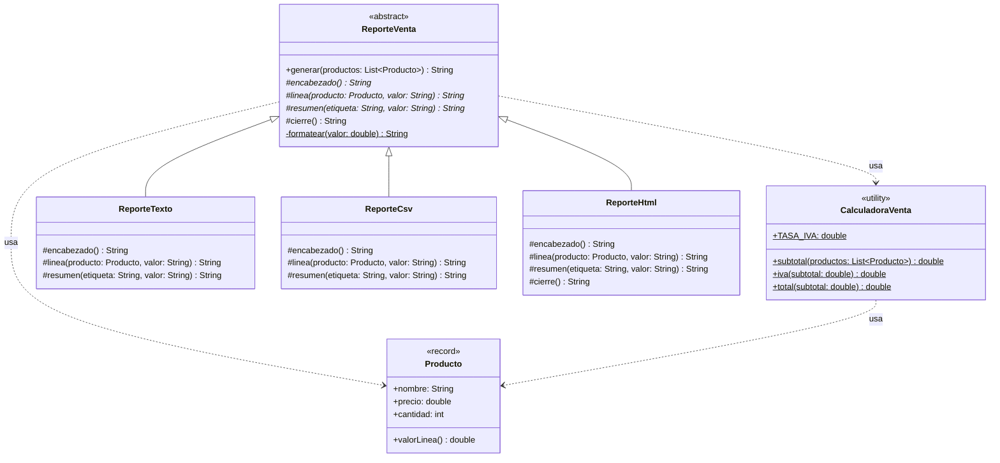

# DRY avanzado — con solución (Template Method)

**Paquete:** `com.udc.reut.cod.app.drykissapp.dry.avanzado.consol`

## Solución
| Responsabilidad | Dónde vive ahora (una sola vez) |
|---|---|
| Validar producto y calcular valor de línea | `Producto` (record con constructor compacto) |
| Tasa de IVA, subtotal, IVA, total | `CalculadoraVenta` |
| Algoritmo del reporte y formato numérico | `ReporteVenta.generar` (método plantilla, `final`) |
| Presentación de cada formato | `ReporteTexto`, `ReporteCsv`, `ReporteHtml` |

Agregar un formato nuevo (JSON, Markdown…) = crear una subclase con tres métodos cortos.
Cambiar el IVA = editar una constante.

> **Relación con KISS:** aquí el patrón **sí** se justifica, porque elimina duplicación real que
> ya existía en tres lugares. En el ejercicio KISS avanzado los patrones se aplicaron sin necesidad.

## Diagrama de clases

