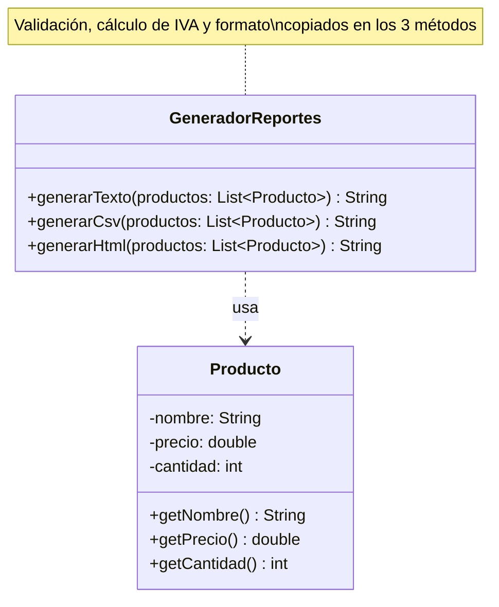

# DRY avanzado — sin solución

**Paquete:** `com.udc.reut.cod.app.drykissapp.dry.avanzado.sinsol`

## Enunciado
`GeneradorReportes` produce el reporte de una venta en **texto**, **CSV** y **HTML**.
Cada reporte muestra los productos (cantidad y valor = precio × cantidad), el subtotal,
el IVA (19 %) y el total.

Los tres métodos repiten el mismo algoritmo y solo cambian la presentación:

```
validar lista ──► recorrer productos ──► validar producto ──► valor línea
       ──► subtotal ──► IVA (0.19) ──► total ──► formatear números
```

Consecuencias:
- La tasa `0.19` y el formato `"%.2f"` aparecen en tres (y hasta nueve) lugares.
- Cambiar el IVA o agregar un descuento obliga a editar los tres métodos de forma idéntica.
- Agregar un formato JSON obliga a copiar el algoritmo una cuarta vez.
- `Producto` no se valida a sí mismo: cada método tiene su copia de la validación, y el error se detecta tarde.

**Tarea:** separar lo que **no cambia** (algoritmo y cálculos) de lo que **sí cambia** (formato)
aplicando el patrón **Template Method**. La salida de los reportes debe ser exactamente la misma.

## Diagrama de clases

