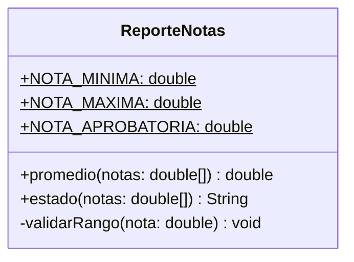

# DRY básico — con solución

**Paquete:** `com.udc.reut.cod.app.drykissapp.dry.basico.consol`

## Solución
- **Un método `promedio(notas)`** sirve para cualquier materia: la materia deja de ser parte del nombre del método y pasa a ser responsabilidad de quien llama.
- **Un método `estado(notas)`** reutiliza `promedio`.
- La validación de rango se extrae a `validarRango`.
- Los valores mágicos pasan a constantes: `NOTA_MINIMA`, `NOTA_MAXIMA`, `NOTA_APROBATORIA`.

Resultado: cambiar la nota aprobatoria = editar **una** línea. Agregar Química = **cero** cambios en la clase.

## Diagrama de clases

