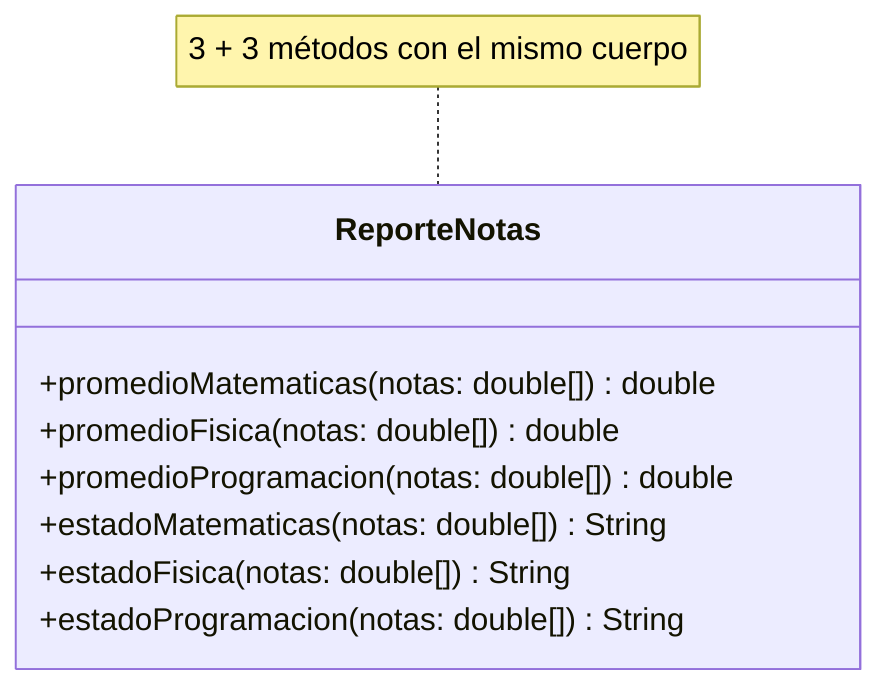

# DRY básico — sin solución

**Paquete:** `com.udc.reut.cod.app.drykissapp.dry.basico.sinsol`

## Enunciado
`ReporteNotas` calcula el promedio y el estado (APROBADO / REPROBADO) de tres materias.
Escala de 0.0 a 5.0; se aprueba con 3.0 o más.

Problemas:
- `promedioMatematicas`, `promedioFisica` y `promedioProgramacion` son **copias exactas**.
- `estadoMatematicas`, `estadoFisica` y `estadoProgramacion` son **copias exactas**.
- Los valores `0`, `5` y `3.0` están escritos en varios lugares (números mágicos).
- Las pruebas también se triplican, porque hay tres copias que pueden divergir.

**Pregunta para el estudiante:** si la nota mínima cambia a 3.5, ¿cuántas líneas hay que editar?
¿Y si se agrega la materia Química?

**Tarea:** dejar una sola implementación de cada regla y una constante por cada valor.

## Diagrama de clases

