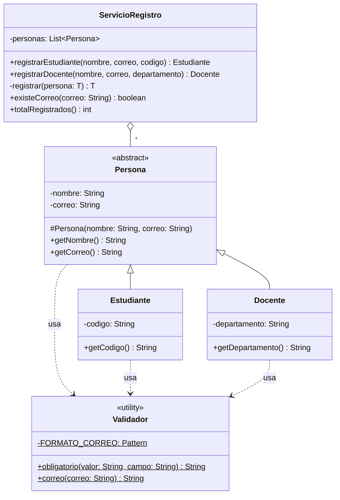

# DRY intermedio — con solución

**Paquete:** `com.udc.reut.cod.app.drykissapp.dry.intermedio.consol`

## Solución
- **`Persona` (abstracta):** contiene `nombre`, `correo`, sus getters y su validación, una sola vez.
  Validar en el constructor garantiza que no puede existir una persona inválida.
- **`Estudiante` / `Docente`:** heredan de `Persona` y solo declaran lo que los diferencia.
- **`Validador`:** única fuente de verdad para "campo obligatorio" (reutilizado para nombre, código y departamento)
  y para el formato del correo (un solo `Pattern` precompilado).
- **`ServicioRegistro`:** una sola `List<Persona>` y un método genérico privado `registrar` con la
  lógica común; los métodos públicos se reducen a una línea.

Las pruebas son idénticas a las de `sinsol`.

## Diagrama de clases

