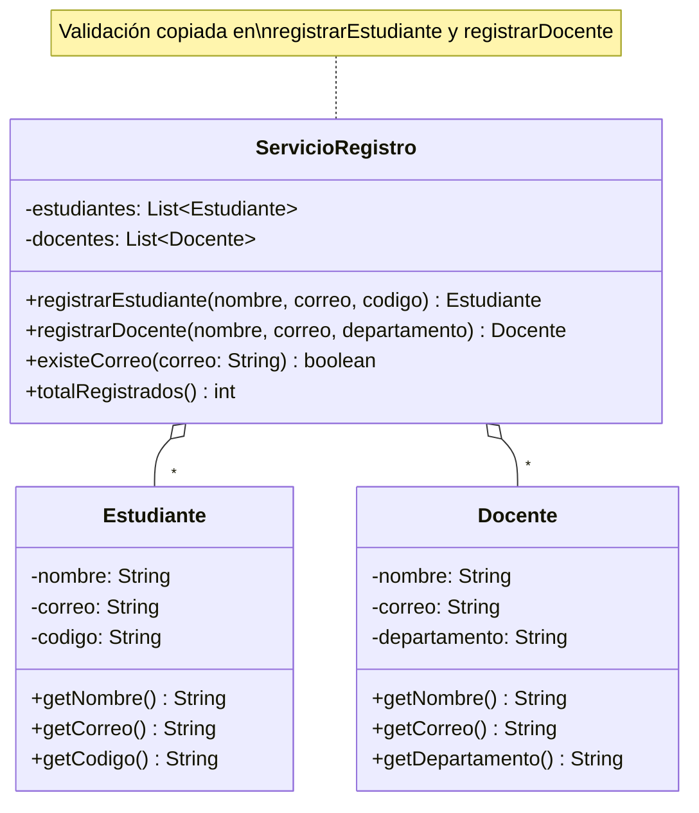

# DRY intermedio — sin solución

**Paquete:** `com.udc.reut.cod.app.drykissapp.dry.intermedio.sinsol`

## Enunciado
`ServicioRegistro` registra estudiantes y docentes con estas reglas:

- Nombre obligatorio (se guarda sin espacios al inicio/fin).
- Correo con formato `usuario@dominio.ext` (se guarda en minúsculas).
- Código (estudiante) y departamento (docente) obligatorios.
- No puede haber dos personas con el mismo correo (aunque una sea estudiante y otra docente).

Duplicación presente:
- `Estudiante` y `Docente` repiten los atributos `nombre`, `correo` y sus getters.
- `registrarEstudiante` y `registrarDocente` repiten ~12 líneas de validación y normalización,
  incluida la expresión regular del correo.
- `existeCorreo` repite el mismo ciclo para cada lista.

**Tarea:** extraer lo común a una superclase `Persona` y a una clase `Validador` reutilizable.
Las pruebas de `ServicioRegistroTest` deben seguir pasando sin modificarse.

## Diagrama de clases

