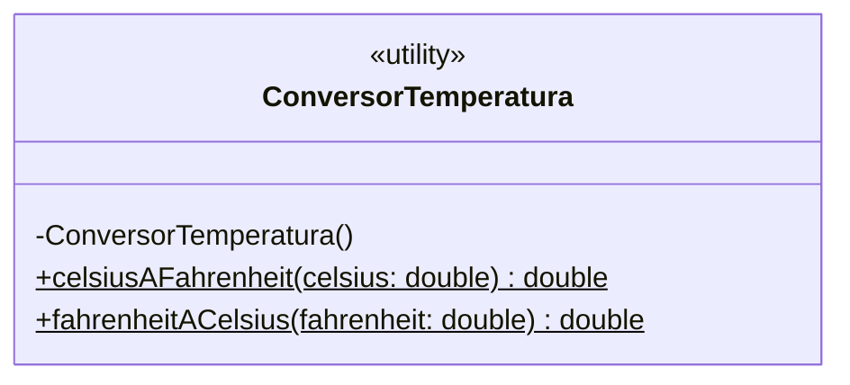

# KISS avanzado — con solución

**Paquete:** `com.udc.reut.cod.app.drykissapp.kiss.avanzado.consol`

## Solución
Los 8 tipos se reemplazan por **una clase utilitaria con dos métodos estáticos**:

- El nombre del método documenta la conversión: no hay códigos `"C_A_F"` que puedan escribirse mal.
  El error que en `sinsol` se detectaba en ejecución, ahora lo detecta el compilador.
- Sin Singleton ni estado global: se prueba llamando al método directamente.
- Si aparece un requisito real (p. ej. Kelvin), se agrega un método. Los patrones se introducen
  cuando un requisito concreto los justifica, no "por si acaso".

> **Reflexión:** los patrones de diseño no son malos; el problema es usarlos sin necesidad.
> Compare con el ejercicio DRY avanzado, donde un Template Method **sí** elimina duplicación real.

## Diagrama de clases

