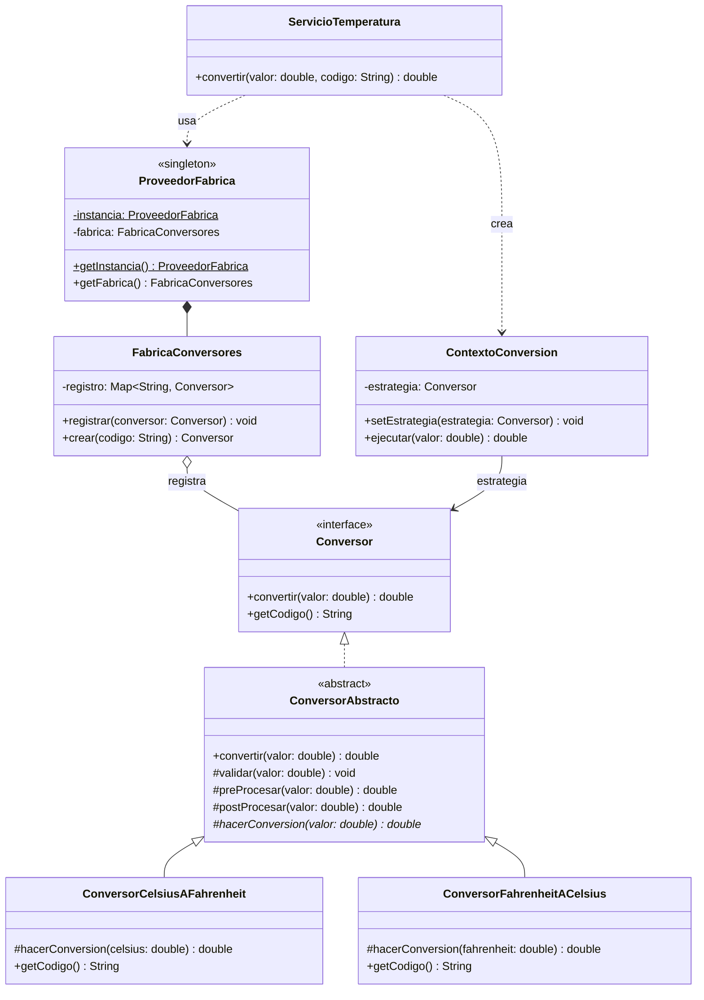

# KISS avanzado — sin solución (sobre-ingeniería)

**Paquete:** `com.udc.reut.cod.app.drykissapp.kiss.avanzado.sinsol`

## Enunciado
Se necesita convertir temperaturas entre Celsius y Fahrenheit (dos fórmulas de una línea).
Para "hacerlo extensible" se aplicaron varios patrones de diseño a la vez:

| Tipo | Patrón | ¿Aporta algo hoy? |
|---|---|---|
| `Conversor` | Interfaz | No: solo hay dos fórmulas fijas |
| `ConversorAbstracto` | Template Method con ganchos | No: los ganchos `preProcesar`/`postProcesar` no hacen nada |
| `ConversorCelsiusAFahrenheit`, `ConversorFahrenheitACelsius` | Strategy | Una clase por fórmula |
| `FabricaConversores` | Factory con códigos `String` | Introduce errores de tipeo que solo se ven en ejecución |
| `ProveedorFabrica` | Singleton | Estado global sin necesidad |
| `ContextoConversion` | Contexto de Strategy | Solo delega |
| `ServicioTemperatura` | Facade | Oculta la complejidad que nosotros mismos creamos |

**Tarea:** reemplazar los 8 tipos por la solución más simple posible (principio YAGNI: *You Aren't Gonna Need It*).
Los casos de conversión de `ServicioTemperaturaTest` deben seguir siendo válidos.

## Diagrama de clases

