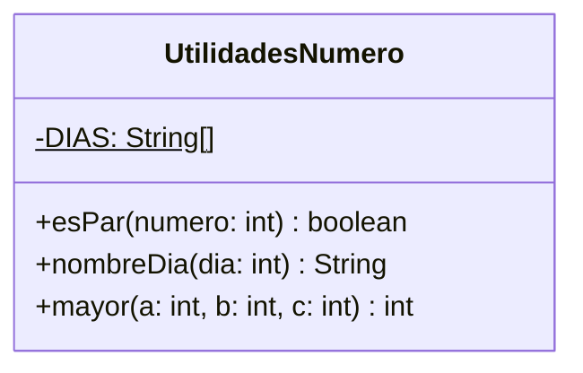

# KISS básico — con solución

**Paquete:** `com.udc.reut.cod.app.drykissapp.kiss.basico.consol`

## Solución
| Método | Antes | Después |
|---|---|---|
| `esPar` | ciclo O(n) + bandera | `numero % 2 == 0` |
| `nombreDia` | 7 `if` anidados | validación de rango + arreglo `DIAS` |
| `mayor` | 4 comparaciones anidadas | `Math.max(a, Math.max(b, c))` |

**Idea clave:** usar lo que ya ofrece el lenguaje y escribir el código más directo que resuelva el problema.
Las pruebas son las mismas que en `sinsol` (más una con `Integer.MAX_VALUE` que la versión con ciclo tardaría en resolver).

## Diagrama de clases

