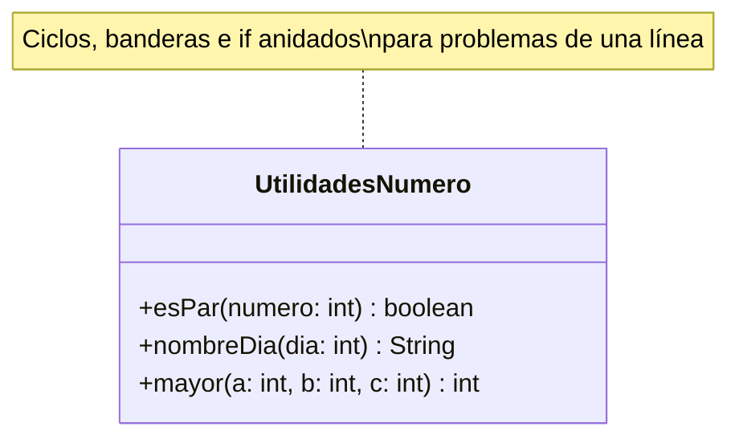

# KISS básico — sin solución

**Paquete:** `com.udc.reut.cod.app.drykissapp.kiss.basico.sinsol`

## Enunciado
`UtilidadesNumero` resuelve tres problemas triviales de forma innecesariamente complicada:

| Método | Qué hace mal |
|---|---|
| `esPar` | Ciclo O(n) con bandera alternada en lugar de `%`. Compara un booleano con `true`. |
| `nombreDia` | Siete `if-else` anidados ("código pirámide"). |
| `mayor` | Compara todas las combinaciones a mano en lugar de usar `Math.max`. |

**Tarea:** simplificar los tres métodos sin cambiar su comportamiento.
Las pruebas de `UtilidadesNumeroTest` deben seguir pasando.

## Diagrama de clases

