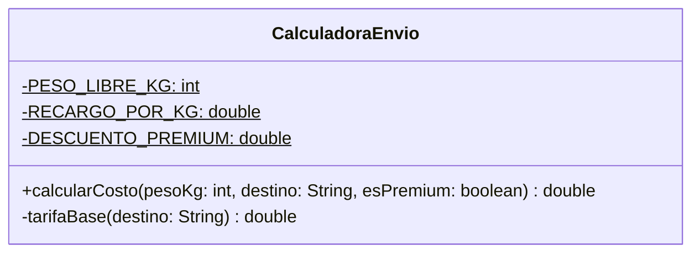

# KISS intermedio — con solución

**Paquete:** `com.udc.reut.cod.app.drykissapp.kiss.intermedio.consol`

## Solución
El método se lee de arriba hacia abajo, en el mismo orden que las reglas de negocio:

1. **Cláusula de guarda:** si los datos son inválidos se lanza la excepción de inmediato.
2. **Tarifa base:** un `switch` sobre el destino normalizado (`toUpperCase`), extraído a `tarifaBase`.
3. **Recargo:** `Math.max(0, peso - 10) * 1000` reemplaza al `if` + `for`.
4. **Descuento:** un operador ternario aplicado una sola vez.

Los números mágicos pasan a constantes con nombre (`PESO_LIBRE_KG`, `RECARGO_POR_KG`, `DESCUENTO_PREMIUM`).
Las pruebas son idénticas a las de `sinsol`.

## Diagrama de clases

