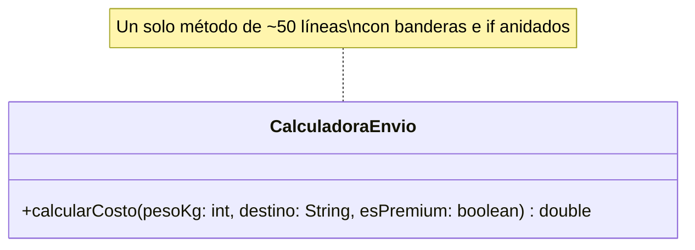

# KISS intermedio — sin solución

**Paquete:** `com.udc.reut.cod.app.drykissapp.kiss.intermedio.sinsol`

## Enunciado
`CalculadoraEnvio.calcularCosto(pesoKg, destino, esPremium)` aplica estas reglas:

- Tarifa base: `NACIONAL` = 5000, `INTERNACIONAL` = 20000 (sin importar mayúsculas).
- Cada kg por encima de 10 kg cuesta 1000 adicionales.
- El cliente premium paga el 50 %.
- Peso ≤ 0, destino nulo o desconocido → `IllegalArgumentException`.

El código actual funciona, pero:
- usa una bandera `esValido` que se arrastra por todo el método,
- tiene `if` anidados en 4 niveles,
- repite la lógica de recargo y descuento en cada rama,
- usa un `for` para calcular `peso - 10`,
- compara el destino con tres variantes del mismo texto,
- decide el error al final, lejos de la causa.

**Tarea:** reescribir el método con cláusulas de guarda, sin banderas y sin ramas repetidas.

## Diagrama de clases

